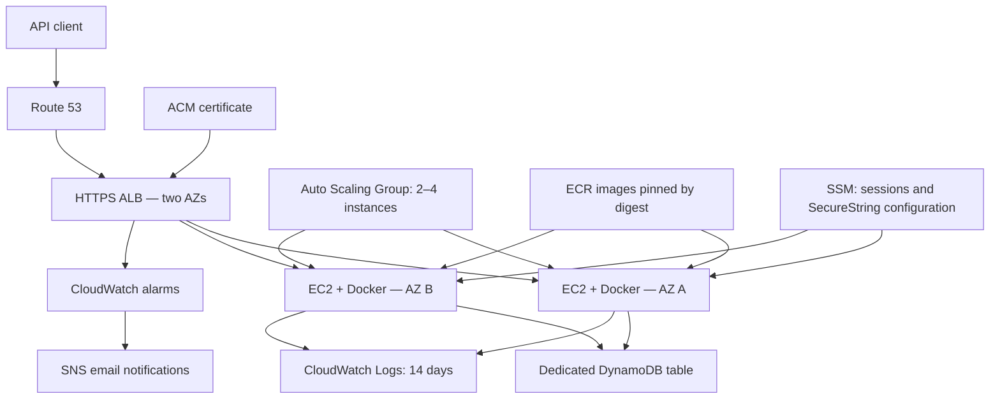

# Notes API on EC2

FastAPI application deployed in Docker containers on AWS EC2, behind an
HTTPS Application Load Balancer, with Terraform and GitHub Actions.

Reuses the domain, service and DynamoDB repository code from
[notes-api-serverless](https://github.com/Gabrielewebdev/notes-api-serverless).

## Project status

Implementation and operational exercises completed in November 2026.
The lab infrastructure is destroyed between sessions to reduce costs.
The API domain is therefore unavailable while the environment is destroyed.

ECR images, the Terraform S3 backend, the API key parameter and deployment
IAM configuration are retained separately.

## Architecture



### Network

- Dedicated VPC: `10.0.0.0/16`.
- Two public subnets in different Availability Zones.
- ALB and EC2 instances use public subnets.
- Instances have public IPv4 addresses for outbound access.
- No NAT Gateway, SSH ingress or bastion host.
- EC2 application ingress is restricted to the ALB security group.

A public subnet is defined by its route to an Internet Gateway.
A public IP does not bypass security group rules.

| Security group | Direction | Port | Source / destination |
|---|---|---|---|
| ALB | Inbound | TCP 80 | Internet; redirects to HTTPS |
| ALB | Inbound | TCP 443 | Internet |
| ALB | Outbound | TCP 8000 | Application security group |
| Application | Inbound | TCP 8000 | ALB security group only |
| Application | Outbound | All | Internet and AWS service endpoints |

### Private subnet alternative

A future alternative is private EC2 subnets with VPC endpoints.
Depending on the configuration, these include ECR API, ECR Docker,
S3, DynamoDB, SSM, SSM Messages and CloudWatch Logs.

Endpoints have their own costs and do not provide general Internet access.
Installing Docker from public package repositories would also require
a suitable package access strategy, such as a prebuilt AMI.

This alternative was documented, not implemented.

## Application

| Method | Path | Purpose |
|---|---|---|
| GET | `/health` | Container and ALB health check |
| POST | `/notes` | Create a note |
| GET | `/notes/{id}` | Read a note |
| GET | `/notes` | List notes with pagination |
| DELETE | `/notes/{id}` | Delete a note |

- FastAPI and Uvicorn.
- Python 3.14.
- 15 passing API tests.
- Multi-stage Docker build.
- Non-root container user, read-only filesystem and dropped capabilities.
- Application managed by a systemd service.
- In-memory repository for local development.
- Dedicated DynamoDB table for AWS deployment.
- DynamoDB listing uses Scan and does not provide chronological ordering.

## Configuration and security

| Variable | Purpose |
|---|---|
| `NOTES_BACKEND` | `memory` or `dynamodb`; defaults to memory |
| `NOTES_TABLE_NAME` | Required for DynamoDB |
| `AWS_REGION` | AWS region; defaults to `us-east-1` |
| `NOTES_API_KEY` | API key supplied through `X-API-Key` |

On EC2, the API key is retrieved at service startup from the Standard
SecureString parameter `/notes-api-ec2/api-key`, encrypted using
`alias/aws/ssm`.

The key is written to a root-readable environment file and passed to Docker.
Its value is not stored in Git or Terraform state.

- `/health` is accessible without a key.
- Notes endpoints require the key in the AWS configuration.
- Missing server-side key configuration blocks DynamoDB-backed requests.
- EC2 uses an IAM instance profile, with no static AWS access keys.
- Administrative access uses Session Manager.
- EBS volumes are encrypted.
- GitHub uses OIDC credentials restricted to this repository and `main`.

A shared API key is suitable for this lab; it is not per-user authentication.
The health endpoint checks application responsiveness, not DynamoDB access.

## Local development

```bash
python3 -m venv .venv
source .venv/bin/activate
python -m pip install -r requirements-dev.lock
python -m pytest -q
uvicorn notes.api:app --host 127.0.0.1 --port 8000
```

Interactive API documentation: `http://localhost:8000/docs`.

```bash
docker build -t notes-api-ec2:local .
docker run --rm -p 127.0.0.1:8000:8000 notes-api-ec2:local
```

Local memory-backed notes are lost when the process restarts.

## Infrastructure as code

Terraform layout:

- `terraform/modules/network/`: VPC, subnets, routing and security groups.
- `terraform/modules/compute/`: IAM, EC2 launch template, ASG, ALB,
  logs, alarms and SNS.
- Root configuration: DynamoDB, ACM, DNS and module wiring.

State is stored in a dedicated S3 bucket with versioning, encryption,
public access blocking and native S3 lock files.

Bootstrap resources and deployment IAM configuration were created separately
and are not removed by the application Terraform configuration.

For local Terraform commands:

```bash
aws login --profile portfolio
export AWS_PROFILE=portfolio
terraform -chdir=terraform init
terraform -chdir=terraform plan
```

The ignored `alerts.auto.tfvars.json` file supplies `alert_email`.
The ignored `release.auto.tfvars.json` file selects the deployed image digest.

## CI/CD

### CI

Pushes to `main` and pull requests run:

1. Python API tests.
2. Docker image build.

### Deployment

A manual workflow or a successful push CI run can trigger deployment.

Automatic deployment requires repository variable
`AUTO_DEPLOY_ENABLED=true`. Keep it `false` when the lab should remain off.

Other repository variables:

- `AWS_ROLE_ARN`
- `ALERT_EMAIL`

Deployment performs:

1. Tests.
2. OIDC authentication.
3. Docker build and push to immutable ECR tags.
4. Image digest resolution.
5. Terraform validation, plan and apply.
6. ASG instance refresh for launch template changes.
7. Wait for the intended launch template version and healthy targets.
8. HTTPS smoke check.
9. Upload of the `deployed-release` artifact.

Rolling updates can temporarily add an instance to preserve capacity.
A successful Terraform apply alone does not prove the rollout has finished.

### Synchronize a deployment locally

After a successful deploy, download its `deployed-release` artifact.
Use the actual run ID:

```bash
rm -f terraform/release.auto.tfvars.json
gh run download RUN_ID --name deployed-release --dir terraform
terraform -chdir=terraform plan
```

The expected result is `No changes`.

Without synchronization, a local apply could select an older image.
Artifacts expire after 30 days; preserve required release references separately.

### Rollback

Select a previous successful release artifact, copy its image configuration
to `terraform/release.auto.tfvars.json`, inspect a saved Terraform plan and
apply it.

Wait for the instance refresh to reach `Successful`, then verify HTTPS,
healthy targets and the intended image version.

Rollback was tested using different image digests. The releases had the same
API behavior; this exercise verified deployment version rollback, not recovery
from an intentionally broken application release.

## Verified exercises

| Exercise | Observed result |
|---|---|
| HTTPS and routing | `/health` returned 200 behind the ALB |
| Authentication | Notes request without a key returned 401 |
| DynamoDB operations | Create 201, read 200, delete 204, subsequent read 404 |
| Instance replacement | ASG replaced a deliberately terminated EC2 |
| Availability sample | A health request during replacement returned 200 |
| Notifications | CloudWatch state transition delivered an SNS email |
| Initial CI/CD deployment | GitHub workflow created the infrastructure and passed health checks |
| Automatic update | Successful CI triggered a rolling deployment |
| Rollback | Previous digest deployed; refresh Successful and two healthy targets |
| Real CPU scale-out | CPU alarm triggered the policy and capacity increased from 2 to 3; the group later reached 4 |
| Capacity reduction | Manually returned desired capacity to 2 |
| Backup and restore | Restored a recognizable note to a separate DynamoDB table |
| Cleanup | Terraform destroyed 38 resources; EC2, ALB and restore-table absence checked |

The availability checks were individual samples, not proof of uninterrupted
service throughout the full exercise.

The notification test forced an alarm state; it did not generate real API 5xx errors.

### Scaling findings

Target tracking uses average CPU utilization with a 60% target.

T3 Standard instances exhausted their CPU credits during the initial test.
For the real scale-out exercise, the two existing instances were temporarily
switched to Unlimited and detailed monitoring was enabled.

The ASG activity history explicitly recorded the high-CPU alarm triggering
the policy and changing desired capacity from 2 to 3.

After testing:

- Load processes were stopped.
- Both original instances were returned to Standard.
- Detailed monitoring was disabled.
- Desired capacity was manually returned to 2.
- Additional instances were terminated.

Automatic scale-in was not verified. The low alarm required 15 one-minute
periods; detailed monitoring had already been disabled.

The launch template remains in Standard credit mode with basic monitoring.
One-minute CPU alarms should be paired with detailed monitoring for responsive
scaling tests. This is a known limitation of the low-cost lab configuration.

### Startup findings

Installing Docker, downloading the image and starting the API took around
five minutes in observed launches.

The ASG health-check grace period was increased from 300 to 900 seconds
after premature replacements were observed.

## Backup and recovery

An on-demand DynamoDB backup containing a known test note was restored to
`notes-api-ec2-restore-test`. A consistent GetItem returned the expected data.

The exercise did not overwrite the application table or switch application
traffic to the restored table.

Both test backups, the restored table and the original test note were removed.

On-demand backup/restore was tested; continuous point-in-time recovery
is not configured by this project.

## Costs and shutdown

EC2, ALB and public IPv4 addresses incur charges while provisioned,
even when no API requests are made.

Additional charges can include EBS, ALB capacity usage, logs, alarms,
ECR, S3, DynamoDB, SNS, backups and KMS requests.

Unlimited CPU surplus and detailed monitoring can add charges during tests.
Actual charges depend on usage, duration, region, credits and applicable taxes.

To shut down:

```bash
gh variable set AUTO_DEPLOY_ENABLED --body "false"
export AWS_PROFILE=portfolio
terraform -chdir=terraform destroy
```

Inspect and confirm the destruction plan. This also deletes the application
DynamoDB table and its notes. Back up required data first.

Wait for `Destroy complete!` and verify that EC2 instances and the ALB
are absent. Resources created manually for exercises require separate cleanup.

Retained resources:

- ECR repository and stored images.
- S3 backend and previous object versions.
- SecureString API key parameter.
- GitHub OIDC provider and deployment IAM configuration.

Retained ECR images and S3 objects can continue to incur storage costs.
Stopping Docker Desktop does not stop AWS resources.

## Potential improvements

- Private EC2 subnets with endpoints and a prebuilt AMI.
- Detailed monitoring consistently configured through Terraform.
- Per-user authentication and request rate controls.
- DynamoDB access patterns that avoid Scan.
- Persistent release metadata beyond workflow artifact retention.
- Deployment smoke tests covering authenticated CRUD operations.
- Broader observability for memory, disk and bootstrap logs.
