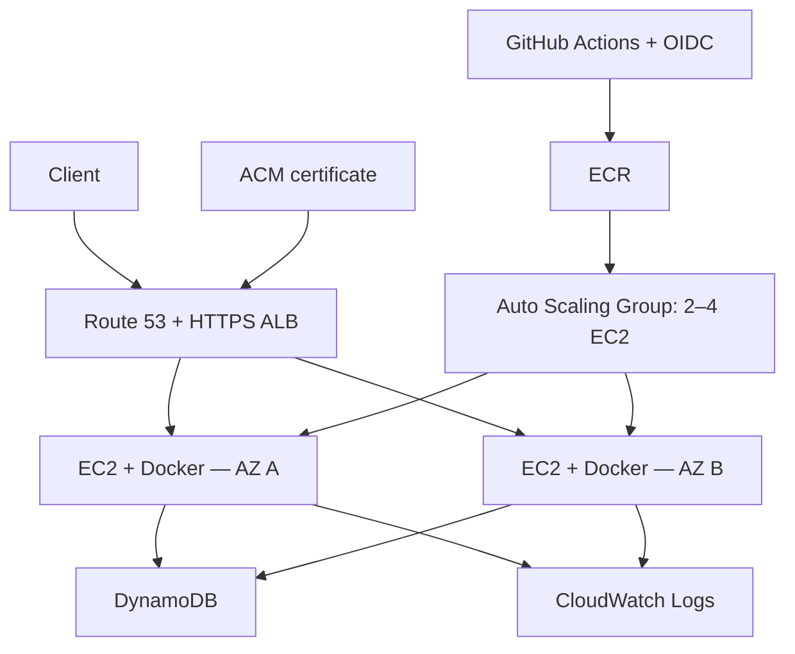

# Notes API — AWS EC2 DevOps Project

A Python API deployed in Docker on AWS EC2, with reproducible Terraform
infrastructure and CI/CD through GitHub Actions.

**Status:** implemented and tested. The lab infrastructure is destroyed
between sessions to reduce costs; a live endpoint is not always available.

## Architecture



Dedicated VPC with two public subnets across two Availability Zones.
EC2 instances accept application traffic only from the ALB security group.
Administration uses SSM Session Manager, with no SSH ingress or NAT Gateway.

## Technologies

| Area | Implementation |
|---|---|
| Application | Python 3.14, FastAPI, Uvicorn, DynamoDB |
| Containers | Multi-stage Docker build, non-root user, read-only filesystem |
| Infrastructure | Terraform network and compute modules, versioned S3 state and native locking |
| Delivery | GitHub Actions, OIDC, immutable ECR tags and image digests |
| Security | ACM HTTPS, instance IAM role, API key in Parameter Store SecureString |
| Operations | systemd, CloudWatch Logs, alarms and SNS email notifications |

## Verified results

- **15 API tests**, plus real authenticated CRUD requests through HTTPS.
- **CI/CD:** successful CI triggered an automatic rolling deployment.
- **Rollback:** deployed a previous image digest and verified healthy targets.
- **Recovery:** ASG replaced a deliberately terminated instance; a sampled
  health request during replacement returned HTTP 200.
- **Real CPU scale-out:** the CPU alarm triggered capacity growth from
  2 to 3 instances; the group later reached 4.
- **Data recovery:** restored a DynamoDB backup to a separate table and
  retrieved the expected test note.
- **Notifications:** a forced CloudWatch alarm state delivered an SNS email.
- **Cleanup:** Terraform destroyed 38 resources; EC2 and ALB absence verified.

Scale-in was performed manually. The CPU test temporarily used T3 Unlimited
and detailed monitoring; both settings were reverted afterward.
The default low-cost configuration uses Standard credits and basic monitoring,
which limits responsiveness of the one-minute CPU scaling alarms.

## API

| Method | Endpoint |
|---|---|
| GET | `/health` |
| POST | `/notes` |
| GET | `/notes/{id}` |
| GET | `/notes` |
| DELETE | `/notes/{id}` |

AWS notes endpoints require the `X-API-Key` header.
`/health` is unauthenticated and checks application responsiveness.

## Run locally

```bash
python3 -m venv .venv
source .venv/bin/activate
python -m pip install -r requirements-dev.lock
python -m pytest -q
uvicorn notes.api:app --host 127.0.0.1 --port 8000
```

Open http://localhost:8000/docs.
Local development defaults to in-memory storage.

## Documentation

See the [technical guide](docs/technical-guide.md) for deployment,
rollback, security groups, recovery exercises, costs and shutdown procedures.
Its relative link to the predecessor project is an external GitHub URL.

Automatic deployment is controlled by `AUTO_DEPLOY_ENABLED`.
Keep it `false` while the environment should remain destroyed.
Manual deployment can still recreate the environment and incur AWS charges.

## Related work

Application logic is reused from
[Notes API Serverless](https://github.com/Gabrielewebdev/notes-api-serverless).

[Personal portfolio](https://gabriele-giancane.com)
